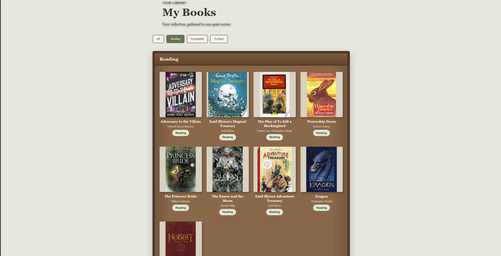
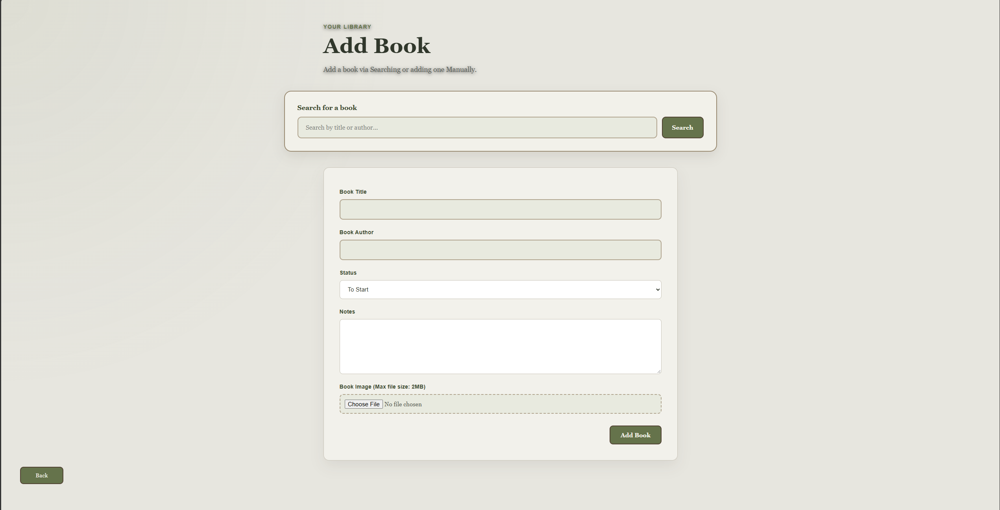
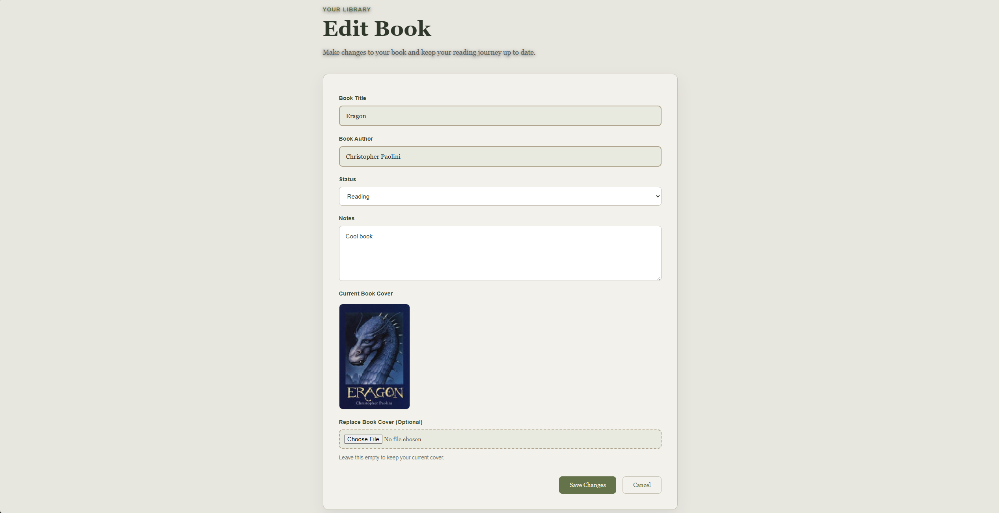

# Bookward 📚

Bookward is a cozy, full-stack reading tracker designed to help readers organize their personal libraries, keep track of reading progress, and read books inside the application using its built-in e-reader.

The project combines a React frontend, a FastAPI backend, and Supabase for authentication, database storage, and user-related data. It also integrates with the Google Books API to help users discover book information.

- **Live application:** [https://bookward.vercel.app](https://bookward.vercel.app)
- **GitHub repository:** [https://github.com/st6rmz/Bookward](https://github.com/st6rmz/Bookward)

**Project status:** Bookward is a deployed personal project with account registration, email verification, login functionality, book-library management, and a built-in reader. Some deployment and email behaviour may depend on the current service configuration.

## Table of Contents

- [Overview](#overview)
- [Features](#features)
- [Screenshots](#screenshots)
- [Technology Stack](#technology-stack)
- [Application Architecture](#application-architecture)
- [Authentication and User Profiles](#authentication-and-user-profiles)
- [Book Library and CRUD Operations](#book-library-and-crud-operations)
- [Built-in E-Reader](#built-in-e-reader)
- [Book Search and External API Integration](#book-search-and-external-api-integration)
- [Database and Data Privacy](#database-and-data-privacy)
- [Visual Design](#visual-design)
- [Project Structure](#project-structure)
- [Getting Started Locally](#getting-started-locally)
- [Environment Variables](#environment-variables)
- [Running the Application](#running-the-application)
- [Security Notes](#security-notes)
- [Known Considerations](#known-considerations)
- [Future Improvements](#future-improvements)
- [Author](#author)

---

## Overview

Bookward was created as a full-stack web development project to bring several reading-related tasks together in one place. Rather than tracking books separately or maintaining a manual reading list, users can create an account, maintain a personal library, organize books by reading status, and use the application's built-in e-reader to read supported books within Bookward.

The application includes a frontend and a backend. The React frontend provides the user interface and communicates with Supabase and the FastAPI API. Supabase handles authentication and stores profile and book-related data, while FastAPI provides backend endpoints for book operations and Google Books search integration.

The project's focus is not only on the visual interface, but also on implementing practical full-stack concepts, including:

- User authentication and account registration
- Database integration and CRUD operations
- REST API development
- External API integration
- User-specific data access and access-control considerations
- Environment-based configuration
- Frontend and backend deployment
- Responsive user-interface design and application styling

## Features

### Account Registration and Authentication

- Create an account using a name, email address, and password.
- Use Supabase Authentication to manage user accounts.
- Verify an email address through the confirmation email sent by Supabase.
- Display a dedicated signup-success page with instructions to check the user's inbox.
- Provide a way to request another confirmation email from the success page.
- Sign in through the login page after account verification.
- Store the display name in signup metadata so the database can create a matching user profile.

### Personal Book Library

- Add books to a personal library.
- View saved books in the library interface.
- Open an individual book's details.
- Edit existing book information.
- Delete books from the library.
- Organize books by reading status:
  - **To Start** — books the user plans to read.
  - **Reading** — books the user is currently reading.
  - **Completed** — books the user has finished.
- Store book details such as title, author, reading status, notes, and an optional cover image.
- Use the library interface to review and manage saved books.

### Built-in E-Reader

Bookward includes a reader interface that allows users to read supported books inside the application rather than having to leave the app to use a separate reader.

The reader is part of the wider reading-tracker experience, keeping book discovery, library organization, and reading together in one application.

The reader's supported formats and available controls depend on the current implementation. Refer to the e-reader screenshot below for a visual representation of the interface.

### Book Search and Google Books Integration

- Integrate with the Google Books API to search for book information.
- Use book-search results to help users find titles to add to their library.
- Support book-cover imagery where image information is available.
- Keep API credentials in environment configuration rather than hard-coding them into source files.

### Seasonal Interface and Visual Design

- A cozy, book-inspired visual identity.
- A dark forest-inspired interface with glass-style panels and warm ambient lighting.
- Four seasonal themes: summer, autumn, spring, and winter.
- Background imagery and decorative particles that create atmosphere.
- Dedicated signup, login, and signup-success experiences designed to fit the application's overall style.

### Backend and Data Handling

- FastAPI backend for API endpoints.
- Supabase database integration.
- Supabase Storage integration for book images.
- Environment-variable configuration for service credentials.
- Cross-Origin Resource Sharing (CORS) configuration for local frontend development.
- Automatic user-profile creation through a database trigger.

## Screenshots

The following screenshots demonstrate Bookward's interface, account functionality, library management, and seasonal dashboard designs.

### Landing Page


### Signup and Email Verification


### Login


### Dashboard

**Summer theme**


**Autumn theme**


**Spring theme**


**Winter theme**


### My Books



### Add a Book



### Edit a Book



### Book Details


### Built-in E-Reader


## Technology Stack

| Technology | Purpose |
|---|---|
| React | Builds the interactive frontend and page interfaces. |
| Vite | Frontend development server and build tooling. |
| React Router | Handles navigation between application pages. |
| JavaScript (ES modules) | Implements frontend behaviour and application logic. |
| FastAPI | Python backend framework for API endpoints. |
| Python | Implements backend functionality. |
| Supabase | Provides authentication, database services, and storage integration. |
| Supabase Auth | Handles user registration, email confirmation, and login. |
| PostgreSQL | Database technology used by Supabase. |
| Supabase Storage | Stores book images where the storage flow is used. |
| Google Books API | Supplies book-search information. |
| Git and GitHub | Version control and source-code hosting. |
| Vercel | Hosts the frontend deployment. |
| Render | Hosts the backend deployment. |

## Application Architecture

Bookward separates its frontend, backend, and hosted authentication and data services.

### High-Level Architecture

```text
                    User
                      |
                      v
              React + Vite Frontend
                      |
          +-----------+-----------+
          |           |           |
          v           v           v
     Supabase      FastAPI     Navigation
       Auth        Backend     and UI State
                      |
               +------+------+
               |             |
               v             v
          Book-related    Google Books
          API operations     API
               |
               v
         Supabase Services
               |
       +-------+--------+
       |       |        |
       v       v        v
   PostgreSQL Profiles  Storage
             and Books  Images
```

### Frontend

The React frontend presents the pages and controls that users interact with. It handles navigation, form input, loading and error messages, and requests to the backend or Supabase.

Vite provides the frontend development server and production build tooling.

### Backend

The FastAPI backend exposes API endpoints used by the frontend for book-related functionality and book search. It also integrates with the Google Books API.

### Supabase

Supabase provides authentication and database-backed information. A database trigger creates a profile when a user signs up, using information supplied in the authentication user's metadata.

### Deployment

- **Frontend:** Vercel — [bookward.vercel.app](https://bookward.vercel.app)
- **Backend:** Render — [bookward-backend.onrender.com](https://bookward-backend.onrender.com)

The deployed frontend and backend must be configured to communicate using the correct environment variables, API URL, and CORS settings.

## Authentication and User Profiles

Bookward uses Supabase Auth for user registration and login.

### Signup Flow

1. The user enters a name, email address, and password on the signup page.
2. The frontend calls Supabase Auth to create the account and sends the name as user metadata.
3. Supabase sends a confirmation email when email confirmation is enabled.
4. A database trigger creates a corresponding row in the `profiles` table using the new user's ID and supplied name.
5. The application navigates to the signup-success page, which explains that the user should check their email.
6. The user follows the confirmation link to verify the email address.
7. After verification, the user can sign in.

The signup-success page indicates that the signup request was accepted. It does not, by itself, mean that the email address has already been confirmed.

### Automatic Profile Creation

The database function `handle_new_user` reads the `user_name` value from the new authentication user's metadata and creates a profile. If the name is missing, the function uses a fallback value.

This approach avoids relying on a separate frontend insert to create the profile and ties profile creation to the account-creation event.

### Login

The login page uses Supabase Auth to authenticate an existing account. Depending on the Supabase email-confirmation settings, an unverified account may be prevented from completing the normal login flow.

## Book Library and CRUD Operations

Bookward implements the four core CRUD operations for managing a personal book collection.

| Operation | Meaning in Bookward |
|---|---|
| Create | Add a book to the library with its title, author, status, notes, and optional image. |
| Read | View the library and open an individual book's details. |
| Update | Edit saved book information. |
| Delete | Remove a book from the library. |

### Reading Statuses

Books can be organized by reading status:

- **To Start:** A book the user plans to read.
- **Reading:** A book currently being read.
- **Completed:** A book the user has finished.

The database stores information such as title, author, status, notes, and image URL. The application uses the backend and database to retrieve and update this information.

## Built-in E-Reader

One of Bookward's key features is its built-in e-reader. It extends the application beyond a simple list of book titles by allowing users to read supported books within Bookward.

This keeps the reading experience connected to the user's personal library and makes reading part of the wider book-tracking workflow.

The e-reader's supported formats, navigation controls, progress tracking, and other capabilities should be documented according to the current implementation.

Refer to the e-reader screenshot in the [Screenshots](#screenshots) section for a visual example.

## Book Search and External API Integration

Bookward integrates with the Google Books API to search for book information. This demonstrates how an application can communicate with an external service and use the returned information as part of a local user workflow.

The backend includes a book-search endpoint in the form:

```text
/books/search?q=...
```

The search implementation checks for a minimum query length before performing a search. Search results can help users find books and associated information, including cover imagery when available.

External API keys should be configured through environment variables and must not be committed to the repository.

## Database and Data Privacy

Bookward uses Supabase's PostgreSQL database for profile and book-related records.

### Main Data Concepts

- **Authentication users:** Managed by Supabase Auth.
- **Profiles:** Store application-level profile information, including the user's ID and display name.
- **Books:** Store book information, including title, author, reading status, notes, image URL, and a user association.
- **Storage:** The `book-images` bucket is used for book-image storage.

The `books` table associates a book with a user through a user ID, while the profile table uses the authentication user's UUID.

Row Level Security (RLS) is enabled on the `profiles` and `books` tables.

**Important security principle:** Enabling RLS is only one part of securing data. The policies must correctly restrict which rows a signed-in user can read or modify. The policies and backend access patterns should be reviewed and tested for `SELECT`, `INSERT`, `UPDATE`, and `DELETE` before private-library access is considered fully verified.

## Visual Design

Bookward uses a cozy, immersive visual style inspired by reading nooks and forest settings. The interface combines dark backgrounds, warm lighting, glass-like panels, seasonal imagery, and subtle decorative elements.

### Seasonal Themes

The application supports four seasonal themes:

- **Summer**
- **Autumn**
- **Spring**
- **Winter**

Each theme provides a different visual atmosphere while preserving the application's core reading-tracker functionality.

The signup, login, and signup-success pages follow the same visual direction so the account-creation experience feels connected to the rest of the application.

## Project Structure

The project is organized into separate frontend and backend directories.

```text
Bookward/
├── frontend/
│   ├── src/
│   │   ├── React pages and application code
│   │   ├── CSS styles
│   │   └── assets and seasonal backgrounds
│   ├── public/
│   ├── package.json
│   ├── vite.config.js
│   └── .env                 # Local configuration; not committed
│
├── backend/
│   ├── main.py              # FastAPI application entry point
│   ├── requirements.txt     # Backend dependencies, if present
│   └── .env                 # Local configuration; not committed
│
├── screenshots/
│   ├── landing-page.png
│   ├── signup.png
│   ├── login.png
│   ├── dashboard-summer.png
│   ├── dashboard-autumn.png
│   ├── dashboard-spring.png
│   ├── dashboard-winter.png
│   ├── mybooks.png
│   ├── add-book.png
│   ├── edit-book.png
│   ├── book-details.png
│   └── book-reader.png
│
├── README.md
└── .gitignore
```

This is a high-level representation of the project structure. Individual files and folders may differ depending on the current implementation. The backend dependency filename and other paths should match the actual repository.

## Getting Started Locally

These instructions describe the general setup process for running Bookward locally.

### Prerequisites

Install or prepare the following:

- Git
- Node.js and npm
- Python compatible with the backend dependencies
- A Supabase project
- A Google Books API key if required for the configured book-search integration

### 1. Clone the Repository

```bash
git clone https://github.com/st6rmz/Bookward.git
cd Bookward
```

### 2. Set Up the Frontend

Navigate to the frontend directory:

```bash
cd frontend
```

Install the frontend dependencies:

```bash
npm install
```

Create a `.env` file in the same directory as the frontend's `package.json`. Configure the required Supabase environment variables as described in the [Environment Variables](#environment-variables) section.

### 3. Set Up the Backend

Open a separate terminal at the main project directory, then navigate to the backend directory:

```bash
cd backend
```

Create a Python virtual environment:

```bash
python -m venv .venv
```

On Windows PowerShell, activate it with:

```powershell
.venv\Scripts\Activate.ps1
```

On macOS or Linux, activate it with:

```bash
source .venv/bin/activate
```

Install the backend dependencies using the dependency file present in the repository. If the backend uses `requirements.txt`, run:

```bash
pip install -r requirements.txt
```

Create a backend `.env` file and configure the Supabase and Google Books values required by the backend.

## Environment Variables

Do not commit `.env` files or real API keys to GitHub.

### Frontend

The frontend uses Vite environment variables. The Supabase client is configured using values such as:

```dotenv
VITE_SUPABASE_URL=your_supabase_project_url
VITE_SUPABASE_KEY=your_supabase_anon_or_publishable_key
```

Only use a key intended for client-side use in the frontend. Never expose a Supabase service-role key or another privileged secret in frontend code.

### Backend

The backend configuration uses values such as:

```dotenv
SUPABASE_URL=your_supabase_project_url
SUPABASE_KEY=your_backend_supabase_key
GOOGLE_BOOKS_API_KEY=your_google_books_api_key
```

Use the appropriate key for the backend operations being performed, and keep privileged credentials private. The exact key type and permissions should match the current Supabase integration.

### Supabase Configuration

For a local setup, make sure that:

- The required database tables and relationships exist.
- The profile-creation trigger and function are configured.
- RLS is enabled and the policies are appropriate for the application's access model.
- The `book-images` storage bucket and its policies are configured if image uploads are used.
- The allowed redirect URLs include the relevant local and deployed URLs for email confirmation.
- The frontend is configured to call the correct local or deployed backend API.

## Running the Application

Run the frontend and backend in separate terminals.

### Start the Backend

Navigate to the backend directory and activate its Python virtual environment.

If the FastAPI instance is exposed as `app` in `main.py`, start the development server with:

```bash
uvicorn main:app --reload
```

The typical local backend address is:

[http://127.0.0.1:8000](http://127.0.0.1:8000)

### Start the Frontend

In a separate terminal, navigate to the frontend directory:

```bash
cd frontend
```

Start the Vite development server:

```bash
npm run dev
```

Vite commonly serves the local frontend at:

[http://localhost:5173](http://localhost:5173)

Open the address printed in the terminal. Make sure the backend CORS configuration allows the local frontend origin and that the frontend is configured to call the correct backend address.

## Security Notes

Security is an important consideration for applications that handle user accounts and personal data.

- Keep environment files and private credentials out of version control.
- Never put a Supabase service-role key in frontend code.
- Configure Supabase Auth redirect URLs for both development and production.
- Use appropriate Row Level Security policies to restrict access to user-specific data.
- Test that one account cannot read, edit, or delete another user's books.
- Validate uploaded image types and sizes on the backend, not only in the browser.
- Treat user-provided notes, titles, and other inputs as untrusted data.
- Avoid logging passwords, authentication tokens, or other sensitive credentials.
- Review backend database access patterns alongside the Supabase RLS policies.

## Known Considerations

- Email confirmation depends on Supabase Auth configuration, redirect URLs, email delivery, and the recipient's ability to open the confirmation link.
- The signup-success page appears after the signup request succeeds; email confirmation is a separate step.
- The local frontend and deployed frontend may use different environment values and redirect URLs.
- Book privacy depends on the actual RLS policies and backend access patterns, not merely on RLS being enabled.
- The built-in reader's supported content and behaviour should be documented according to the current implementation.
- External API availability and image metadata depend on the Google Books API response.
- Local development requires the frontend and backend to use compatible configuration values and allowed origins.

## Future Improvements

Potential next steps for Bookward include:

- Further testing of authentication, session persistence, and sign-out behaviour.
- A thorough review of Supabase RLS policies for all user-owned records.
- More robust error handling and user feedback for network and API failures.
- Backend validation for image uploads, including size and content type.
- Automated tests for authentication and book CRUD operations.
- Improved accessibility and responsive-layout testing across devices.
- Additional reader features, depending on the formats and controls supported by the current reader.
- More detailed setup documentation as the project structure stabilizes.

## Author

**Jeremy Singh**

Computer Engineering graduate specializing in Software Engineering.

- **GitHub:** [https://github.com/st6rmz](https://github.com/st6rmz)
- **Project repository:** [https://github.com/st6rmz/Bookward](https://github.com/st6rmz/Bookward)
- **Live application:** [https://bookward.vercel.app](https://bookward.vercel.app)

Bookward is a personal portfolio project built to practise and demonstrate full-stack web development, authentication, database integration, API consumption, and application design.